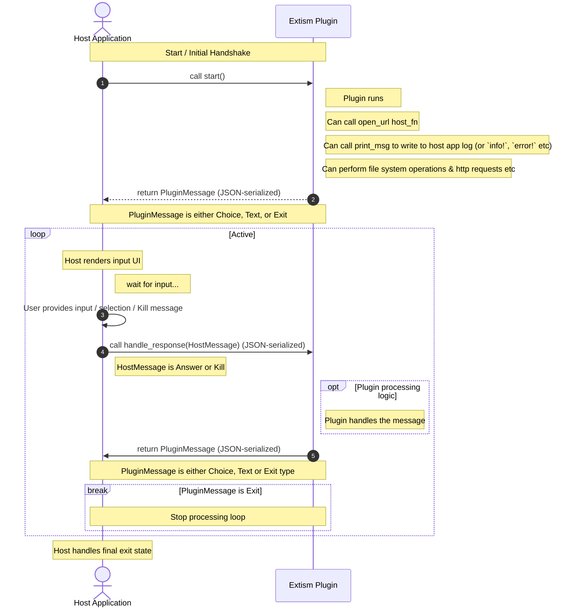

# Pocket-Check

An [openFPGA Pocket updater plugin](https://github.com/openfpga-library/pocket-plugin) (Pocket Sync, pupdate and other
hosts) that scans your Analogue Pocket SD card for missing, empty, orphaned or mismatched ROMs and
instance `.json` files, and writes a report. It is a Rust port of the `Pocket-Check.py` script.

Pocket-Check never changes your games, cores or settings. The only files it writes are its own report and ignore
list (plus an optional manifest you create yourself), in the plugin's own folder on the SD card. Nothing is written
to your computer.

## Features

- Scans the `Cores`, `Assets`, `Platforms` and `Presets` folders and cross-checks them against each other
- Reports problems and notes separately; notes are informational and are not counted as problems
- Menu driven: scan the whole card or a single platform, and choose whether to include `.sav` and
  Analogizer files
- Ignore list for anything you don't want reported (cores, folders, files)
- Optional manifest of expected ROM sizes
- Full text report written to a file, with a short summary in the updater log for long reports

## What is checked

**Cores** (`/Cores/<Author.Core>/`)
- Folder name is `AuthorName.CoreName` and matches the author and shortname in `core.json`
- `core.json`, `data.json`, `video.json`, `input.json`, `interact.json`, `audio.json` and `variants.json`
  are present and valid JSON
- Bitstream files named in `core.json` exist (with exact letter case)
- Fixed-filename data slots in `data.json` (BIOS files etc.) exist in `/Assets/<platform>/common` or
  `/Assets/<platform>/<Author.Core>`, are not empty, and have no more than 32 slots / 31 character names

**Assets** (`/Assets/<platform>/...`)
- Every instance `.json` is valid: correct magic, no more than 32 slots, unique and valid slot ids,
  forward slashes in `data_path`
- Missing ROMs: files an instance `.json` lists that can't be found
- Case mismatches: reported one line per folder, showing the path the JSON asks for versus the path on the card
- Empty (0-byte) ROMs
- Orphan ROMs: `.rom` files that no instance `.json` uses
- Size mismatches, when a manifest is provided

**Platforms** (`/Platforms/<platform_id>.json`, `/Platforms/_images/<id>.bin`)
- Every platform used by an installed core has a valid JSON (name, category and manufacturer of 31
  characters or fewer, integer year) and an image
- Platform ids follow the naming rules (`a-z`, `0-9`, `_`, 15 characters or fewer)
- Platform JSONs that no installed core uses

**Presets** (`/Presets/<Author.Core>/{Interact,Input}/<platform>/<Author.Core>/<game>.json`)
- Every preset parses and has the right top-level key and magic
- Orphan presets with no matching instance `.json`
- Instance `.json` files that are missing a preset (for cores that use presets)

## Skipped by default

- `.sav` files (created by the Pocket at runtime)
- Analogizer / CRT config items: `crtcfg.bin`, `analogizer.bin`, `analogizer.json`, `/Assets/analogizer`
  and the `analogizer` platform
- Beta items: `jtpatreon.bin`, `jtpatreon.json`, `coinopkey.bin`, `coinopkey.json` and the `jtpatreon` and
  `coinopkey` platforms
- macOS AppleDouble files and folders (names starting with `._`)

The `.sav` and Analogizer items can be included from the menu. The beta items are always skipped.

## Using the plugin

1. Run the plugin from your updater app.
2. Choose **Scan the whole card** or **Scan one platform...** (enter a platform id or a glob such as
   `jtbubl` or `jt*`; several can be separated with commas).
3. Choose what to check: **Default**, **Also check .sav files**, **Also check Analogizer/CRT files**
   or **Check .sav and Analogizer files**.
4. Read the summary in the log, or open `Pocket-Check-Report.txt` from the plugin's folder on the SD card for the full report.

The plugin's version is shown in the title of each menu, so you can tell which build is running.

## Files

These are kept on the SD card, in the plugin's own folder, where pupdate installs the plugin:
`\plugins\OngoGablogian.pocket-check-plugin\` (next to `plugin.wasm` and `plugin.json`). If that folder can't be
written to, the plugin uses the root of the SD card instead. Nothing is written to the computer, and the log says where
each file ended up.

| File | Purpose |
| --- | --- |
| `Pocket-Check-Ignore.txt` | Your ignore list. Created with instructions the first time the plugin runs. |
| `Pocket-Check-Report.txt` | The full report. Rewritten on every run. |
| `Pocket-Check-Manifest.json` | Optional. Expected ROM sizes: `{ "sf2.rom": { "size": 4194304 } }` (keys are matched case-insensitively). |

If an earlier version left an ignore list in the root of the SD card or in the updater's private plugin folder on the
computer, it is copied to the plugin's folder on the SD card the first time you run v0.2.1 or newer. The old copy is
left in place and is no longer used, so you can delete it.

The folder name comes from the GitHub owner and repository name (`<owner>.<repo>`). If you publish the plugin under a
different owner or name, change `PLUGIN_DIR` at the top of the file-location code in `plugin/src/lib.rs` to match.

### Ignore list

One entry per line. Lines starting with `#` (and anything after ` #`) are comments. Matching is
case-insensitive and `*` and `?` wildcards are allowed.

```text
# a core folder name - the core is skipped everywhere (for console cores that don't use instance .json files)
Mazamars312.PC Engine CD

# a path from the SD root, as shown in the report - a folder covers everything inside it
Assets/ng/common/uni-bios_4_0.rom
Assets/*/common/*.rom

# a bare file name - hides problems about that file anywhere on the card
uni-bios_4_0.rom
```

Everything that was ignored is listed in the report under **Ignored cores**, **Ignored folders** and
**Ignored files**, and entries that matched nothing are listed as a note.

### Report

The report has a header with the date and what was skipped, then one `== Category (N) ==` section per kind of
problem, followed by notes, the ignored items and a final line such as `12 problem(s) found.` or
`No problems found.`

## Differences from the Python script

- Options are chosen from a menu instead of command-line flags
- No CRC32 checking (the manifest checks sizes only), and no `--rom-ext`, `--no-orphans`, `--no-cores`,
  `--out` or `--no-report` options
- The ignore list supports `*` and `?` wildcards only (no `[abc]` sets)
- Old `Ignore-Cores.txt` / `ignore_cores.txt` files are not carried over

## Building

You'll need to `rustup target add wasm32-wasip1` if you've not got it already, then:

```sh
cargo build -p plugin --target wasm32-wasip1
```

To try it in the demo host app against a copy of a Pocket SD card (or a folder with the same layout):

```sh
cargo run -p demo_host -- --folder-plugin ./target/wasm32-wasip1/debug --pocket-path /path/to/pocket-sd --host-folder ./host_folder
```

Run `cargo clean` afterwards if you want the disk space back.

## Releasing

Create a GitHub release whose assets are `plugin.wasm` and `plugin.json`. The included
`.github/workflows/add_to_release.yml` builds and attaches both when you publish a release. Users add the plugin
by giving their updater app the repo link; the app finds the latest release and keeps it up to date.

See [CHANGELOG.txt](CHANGELOG.txt) for the version history.

## Plugin template reference

Pocket-Check is built on the [pocket-plugin](https://github.com/openfpga-library/pocket-plugin) template. The
original template documentation follows, for anyone writing their own plugin.

### What can be done with a Pocket Plugin?

- Create, read, write, list, and modify arbitrary files on the Pocket, with full access to the pocket's filesystem
- Run exactly the same plugin in pupdate, Pocket Sync, and any other app that comes along.
- Make HTTP requests from the plugin (using extism's `http` module)
- Store files & cache on the user's computer, in a sandboxed folder dedicated to the plugin
- Print log information to the user as the plugin processes
- Ask for 2 types of input from the user - multiple choice (for menus etc) & free text input (for keys, tokens, etc)
- Open urls in the user's browser (to confirm an upload happened, open a key management portal, etc)

### Tips

- Because WASM & Extism plugins are single threaded there's a few things to consider:
  - If you want to download big files without having the user think they're stalled consider downloading them in chunks using range headers & showing progress via the log.
  - There isn't a nice way to gracefully shut down the WASM plugin mid-way, so write defensively (e.g. if a file named `file.txt` is being modified; first copy it to `file_copy.txt`, do the modifications, then rename `file_copy.txt` to `file.txt`)
  - The host app will handle notifying the WASM app that the user's chosen to quit (via the `Kill` HostMessage), but the Plugin won't actually quit until the Plugin returns the `Exit` PluginMessage so any confirmation / clean up etc can happen
- Use the `print()` host_fn often so the user knows the plugin is running - note that this is a `print` rather than a `println` so the app should ouput `this is a log.\n`.
- The `PluginMessage` & `HostMessage` are Rust enums, encoded into JSON by serde using the [deafult externally tagged representation](https://serde.rs/enum-representations.html#externally-tagged) so you will get `HostMessages` that look like
```json
{"Answer": {"name": "...", "value": "..."}}
```
or
```json
{"Kill": {}}
```

### To build
You'll need to `rustup target add wasm32-wasip1` if you've not got it already, then
`cargo build -p plugin --target wasm32-wasip1`
Then run
`cargo run -p demo_host -- --folder-plugin ./target/wasm32-wasip1/debug`

(or `cargo build -p plugin --target wasm32-wasip1 && cargo run -p demo_host -- --folder-plugin ./target/wasm32-wasip1/debug`)

should run the example plugin within the demo app.

The demo_host app can be told to look at the actual Pocket SD card, see what's available with `cargo run -p demo_host -- --help`.

The demo host app is more complex than I'd hoped, but most of that's just getting the tokio channels to send data between the task that's running the plugin & the UI one. The actual Plugin running code is fairly simple, I think.

### To test other plugins

Use the `demo_host` here to test other plugins via `cargo run -p demo_host -- --folder-plugin [your folder contaning the wasm & json file] --log-level trace`.

(note for non-rust devs, run `cargo clean` after you're done since Rust will casually eat up gigabytes worth of space storing build assets etc)

### To release

To release a plugin create a github repo that has releases which contain `plugin.wasm` & `plugin.json` files [like this repo does](https://github.com/openfpga-library/pocket-plugin/releases/tag/v0.0.2) (other non-github platforms might be supported in the future).

To tell users about the plugin give them the repo link e.g. `https://github.com/openfpga-library/pocket-plugin` and the host apps will look up the latest release, find the json & wasm, load them for the user, and keep them up to date (using the release title as the version number).

### Flow

The plugin must define at least a `start` `plugin_fn` (no arguments), if it doesn't need to ask the user for input.
If it needs to ask the user for input it'll also need a `handle_response` `plugin_fn` which recieves the `HostMessage` enum, JSON serialised - which can either be a response to a `PluginMessage` that's asked for input, or a signal to kill the plugin.

The host must define a `open_url` `host_fn` which takes a url as a string and should open it in the user's browser.
The host must define a `print_msg` `host_fn` which takes a message as a string and should log it (acts like `print` rather than `println` so the plugin has to care about newlines etc).

The host should respond to the 3 possible `PluginMessage` options (`Choice`, `Text`, `Exit`) by:
- rendering UI with a multiple choice
- rendering UI for a free text prompt
- letting the user know the plugin's finished (or whatever makes sense, returning the user to the main app etc)



### TODO
- [x] Sketch out host_fns & plugin_fns
- [x] Rough Demo & app
- [x] Add another folder accessible by the plugin on the host machine (empy folder, sub-directory on the app directory, exposed as `computer/` or something)
- [x] Tidy this up generally
- [x] Add logic & schema for the JSON file that'll be beside a plugin that tells us the name, a description, what hosts it wants to access (with a wildcard option) etc
- [x] Document how the Plugin system works for non-Rust plugins (not 100% sure how the enums are encoded etc)
- [ ] ~~Generate a schema https://github.com/extism/rust-pdk#generating-bindings~~ looks like v1 of this is still a draft, maybe later
